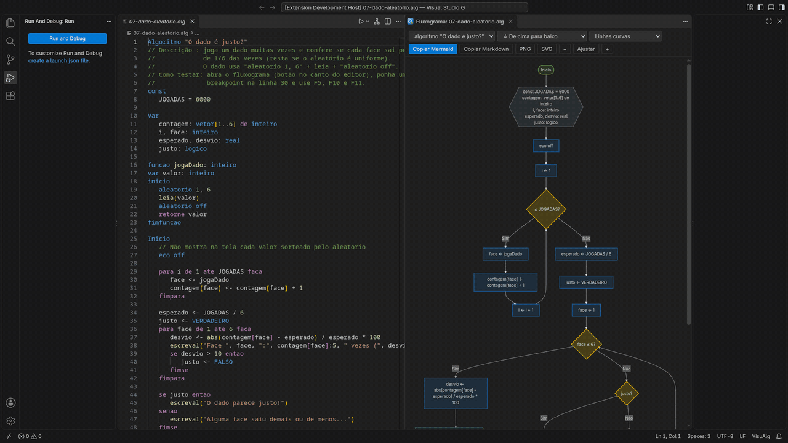
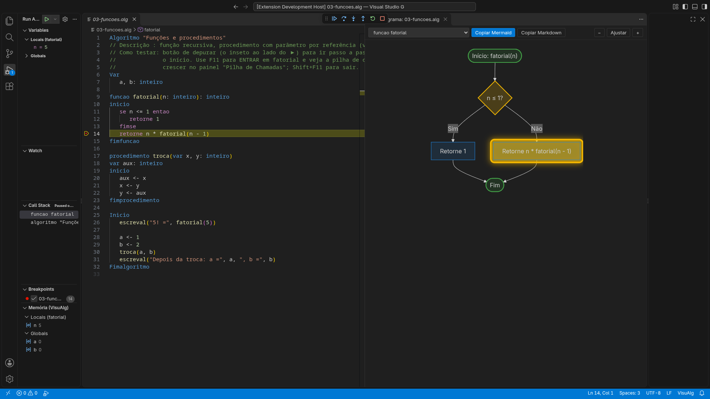
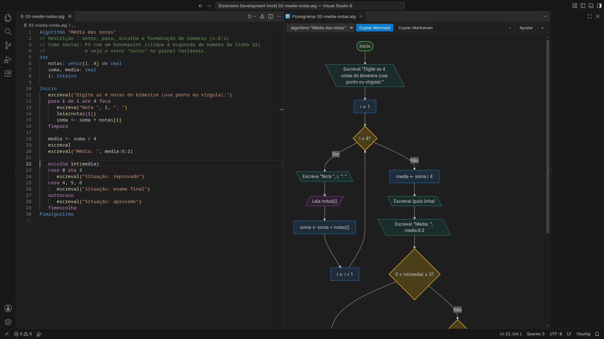
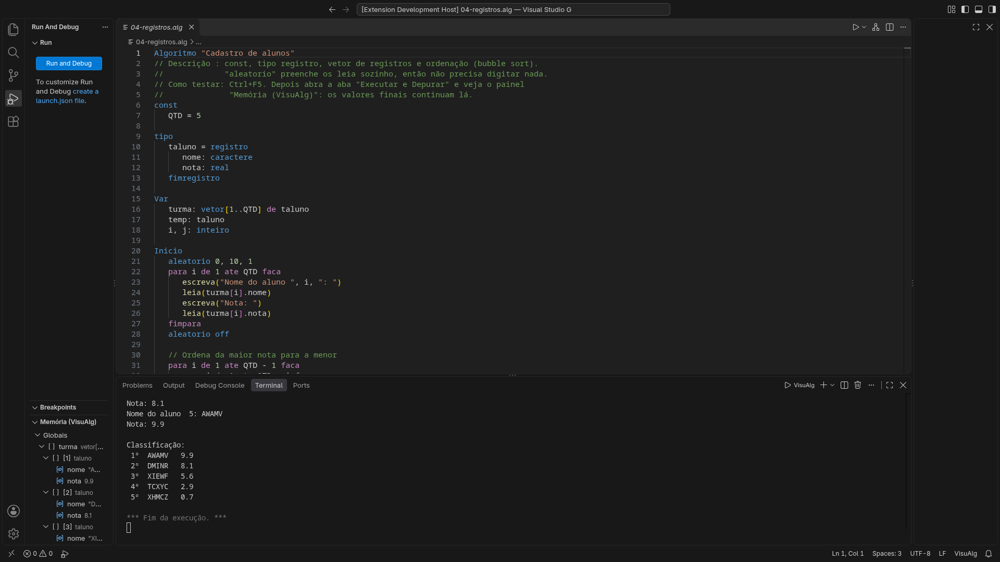
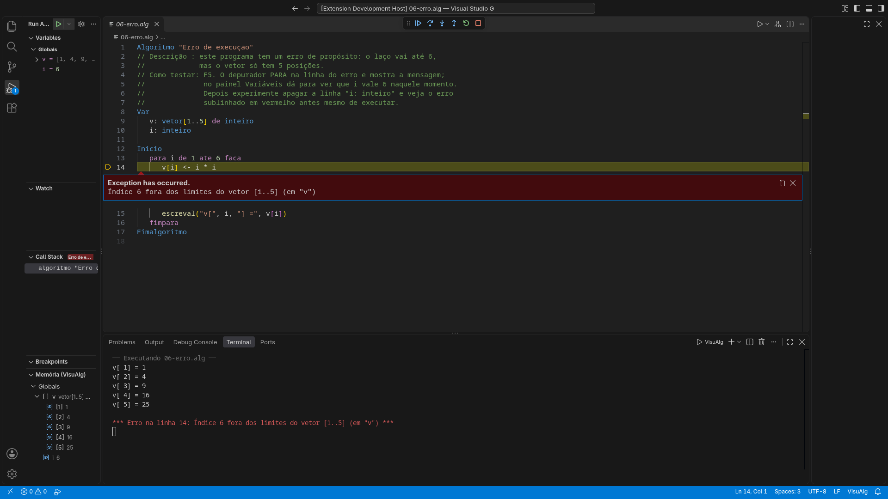
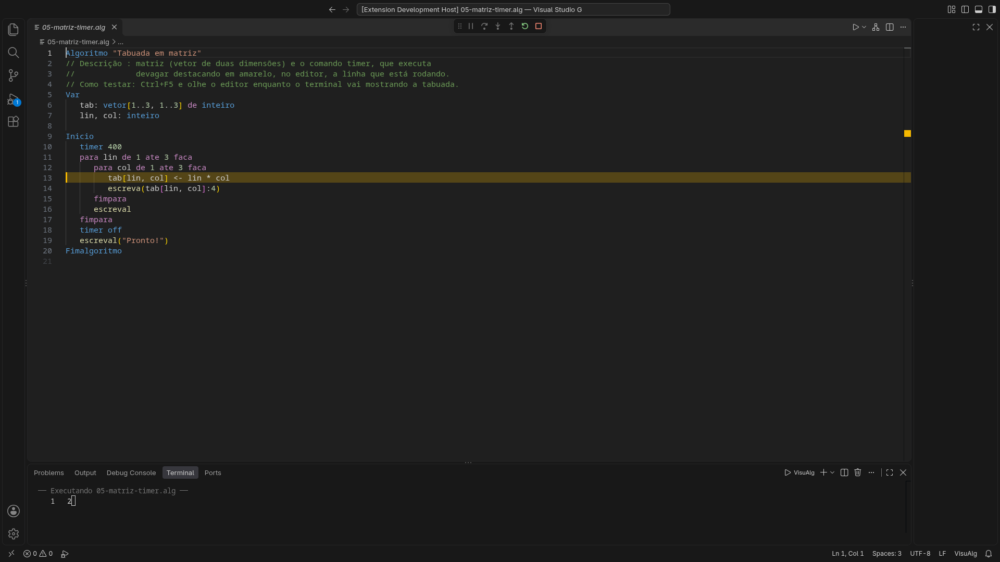

<p align="center">
  
</p>

<h1 align="center">Visual Studio G</h1>

<p align="center">
  <b>VisuAlg (Portugol) dentro do VS Code.</b><br>
  Execute, depure linha por linha e acompanhe as variáveis, em Linux, macOS ou Windows,<br>
  sem precisar instalar o VisuAlg nem o Wine.
</p>

<p align="center">
  <a href="https://github.com/eduardo-moro/visual-studio-g/actions/workflows/ci.yml"></a>
  
</p>

---

O VisuAlg é ótimo para aprender lógica de programação, mas só roda no Windows e o editor dele é bem limitado. A **Visual Studio G** traz a linguagem do VisuAlg para o VS Code, com um interpretador próprio: você escreve o mesmo código das aulas e ganha um depurador de verdade, erros enquanto digita e tudo o que o VS Code oferece.



## Recursos

- **Executar** com `Ctrl+F5` ou com o botão **▶** no canto do editor. O programa roda no terminal **VisuAlg**, e é ali que você digita o que o `leia` pede.
- **Depurar** com `F5`: breakpoints, passo a passo (`F10`, `F11`, `Shift+F11`), pilha de chamadas e painel de **Variáveis** com vetores, matrizes e registros. Dá para mudar o valor de uma variável com duplo clique.
- **Passo a passo desde a primeira linha** (o F8 do VisuAlg) com o botão do inseto, ao lado do ▶.
- **Fluxograma** do algoritmo numa aba ao lado do código (botão no canto do editor): início e fim, decisões com Sim/Não, laços, leituras e escritas, um fluxograma para cada procedimento e função. Ele se atualiza enquanto você digita, clicar num bloco leva à linha do código e, **durante a depuração, o bloco que está executando acende**. Dá para copiar o código [Mermaid](https://mermaid.js.org) (ou um bloco Markdown pronto para GitHub, Notion, Obsidian...).
- **Painel Memória (VisuAlg)**, como a área de variáveis do VisuAlg: mostra os valores ao vivo, mesmo sem depurar, e guarda os valores finais quando o programa termina.
- **Erros de execução** (índice fora do vetor, divisão por zero...) param o depurador na linha certa, com as variáveis ainda visíveis.
- **Erros enquanto você digita**, em português: variável não declarada, `fimse` faltando, tipo errado...
- **`timer`** destaca no editor a linha que está rodando, em câmera lenta.
- Destaque de sintaxe, trechos prontos (`algoritmo`, `se`, `para`, `procedimento`...), autocompletar, documentação ao passar o mouse, estrutura do arquivo e **formatação automática** (`Shift+Alt+F`).
- Arquivos `.alg` salvos pelo VisuAlg no Windows abrem com os acentos certos.



| Fluxograma | Memória ao vivo |
|---|---|
|  |  |

| Parando num erro | `timer` |
|---|---|
|  |  |

## Como usar

1. Instale a extensão (procure **Visual Studio G** na aba de extensões).
2. Abra ou crie um arquivo `.alg`. Para começar do zero, digite `algoritmo` e aperte `Tab`.
3. Aperte `Ctrl+F5` para executar ou `F5` para depurar.

| O quê | Atalho |
|---|---|
| Executar | `Ctrl+F5` ou ▶ |
| Depurar | `F5` |
| Passo a passo desde o início | botão do inseto ao lado do ▶ |
| Breakpoint | clique à esquerda do número da linha |
| Próxima linha / entrar / sair da função | `F10` / `F11` / `Shift+F11` |
| Continuar / parar | `F5` / `Shift+F5` |
| Interromper o programa | `Ctrl+C` no terminal VisuAlg |
| Formatar | `Shift+Alt+F` |
| Fluxograma | botão de fluxograma no canto do editor, ou `Ctrl+Shift+P` → "Mostrar fluxograma" |

A pasta [`exemplos`](exemplos) tem programas prontos para testar cada recurso. O da animação acima é o [`07-dado-aleatorio.alg`](exemplos/07-dado-aleatorio.alg): joga um dado 6000 vezes com `aleatorio` + `leia` e confere se cada face sai perto de 1/6 das vezes.

## Linguagem suportada

Tudo o que está no manual do VisuAlg 3.0:

- Tipos `inteiro`, `real`, `caractere` (`caracter`, `literal`), `logico`, `vetor` com uma ou mais dimensões e qualquer faixa de índices, `const`, `tipo ... registro`.
- `se / senao`, `escolha / caso` (com listas e faixas como `caso 1 ate 5`), `para ... passo`, `enquanto`, `repita ... ate`, `repita ... fimrepita`, `interrompa`.
- `procedimento` e `funcao` com parâmetros por valor e por referência (`var`), e recursão.
- `escreva` / `escreval` com formatação (`x:6:2`) e `leia`.
- Funções: `abs`, `int`, `raizq`, `quad`, `exp`, `pot`, `log`, `logn`, `sen`, `cos`, `tan`, `cotan`, `arcsen`, `arccos`, `arctan`, `grauprad`, `radpgrau`, `pi`, `rand`, `randi`, `asc`, `carac`, `caracpnum`, `numpcarac`, `compr`, `copia`, `pos`, `maiusc`, `minusc`, `mod`, `div`, e também `esquerda`, `direita`, `etrim`, `dtrim`, `replicar`.
- Comandos especiais: `aleatorio`, `arquivo`, `timer`, `pausa`, `debug`, `eco`, `cronometro`, `limpatela`, `mudacor`.

Como no VisuAlg, palavras-chave e nomes de variáveis não diferenciam maiúsculas, minúsculas nem acentos (`ENTÃO` é o mesmo que `entao`).

Encontrou um programa que funciona no VisuAlg e não funciona aqui? [Abra uma issue](https://github.com/eduardo-moro/visual-studio-g/issues/new/choose) com o código.

## No terminal

O interpretador também roda fora do VS Code:

```sh
git clone https://github.com/eduardo-moro/visual-studio-g
cd visual-studio-g
npm install && npm run build
node dist/cli.js exemplos/01-ola.alg
```

## Contribuindo

Contribuições são muito bem-vindas, principalmente de quem está aprendendo! Veja o [CONTRIBUTING.md](CONTRIBUTING.md).

## English

**Visual Studio G** runs and debugs VisuAlg programs (the Portuguese pseudocode used to teach programming in Brazilian schools and universities) inside VS Code, on any OS. It ships its own interpreter, a full debugger (breakpoints, stepping, variables, call stack), a live flowchart view (Mermaid) that highlights the running block while debugging, live diagnostics, a formatter and a live memory view. MIT licensed.

## Créditos

Criado por [Eduardo Moro](https://github.com/eduardo-moro), com o código escrito em parceria com o **Claude** (Anthropic), pelo Claude Code: interpretador, depurador, fluxograma, testes, ícone e esta documentação.

Os fluxogramas são desenhados com o [Mermaid](https://mermaid.js.org) (veja [THIRD_PARTY_NOTICES.md](THIRD_PARTY_NOTICES.md)). A linguagem segue o manual e os exemplos do VisuAlg 3.0.

---

O nome é uma brincadeira com Visual Studio + VisuAlG. Este projeto não é afiliado à Microsoft nem aos autores do VisuAlg.
